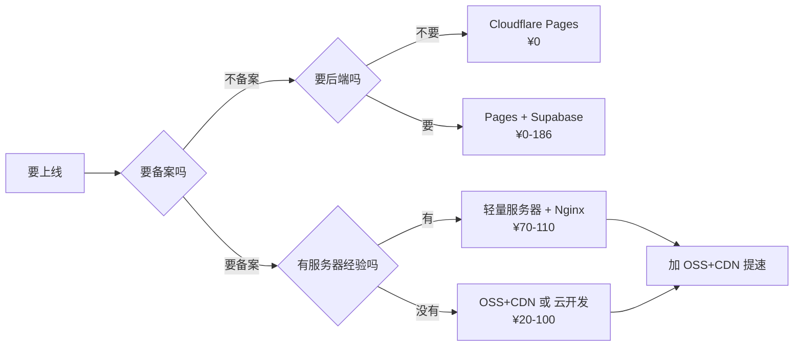

# 上线方式与成本 · 全方案详解

> 目标：把"这个站怎么放到互联网上、要花多少钱"讲透。
> 覆盖 **15 种上线方式**、**4 档规模**、**6 种组合报价**、**域名与备案全流程**。
> 价格为 2026 年公开报价的区间估算，下单前以官网为准。
> 配套工具：`tools/cost.html`（打开即可按你的规模算月成本）。

---

## 0. 先给结论

| 你的情况 | 推荐路线 | 月成本 |
|---|---|---|
| 只想让人看到、还没人真的用 | Cloudflare Pages（纯静态） | **¥0**（+域名约 ¥6/月） |
| 想让别人也能注册、写笔记 | Pages + Supabase 免费档 | **¥0–6** |
| 用户开始多了（日活 300+） | Pages + Supabase Pro | 约 **¥200** |
| 要接国内广告、要备案、要低延迟 | 国内轻量服务器 + OSS/CDN | **¥200–350** |
| 日活 5000+ | 轻量升级 + CDN + 队列 | **¥600–1200** |

**一句话**：你这种"文字为主"的站，机器成本极低，真正贵的是**备案时间**和**内容审核的人力**。

---

## 1. 先搞清楚你的站属于哪一类

这决定了你能用哪些方案、花多少钱。

| 类型 | 特征 | 本站当前 | 可选方案 |
|---|---|---|---|
| **纯静态** | 只有 HTML/CSS/JS，数据存浏览器 | ✅ 现在就是 | 所有静态托管 |
| **半动态** | 静态页面 + 第三方后端（认证/数据库） | 接 Supabase 后 | 静态托管 + BaaS |
| **全动态** | 自己的服务端渲染/API | 将来可选 | 服务器 / Serverless / PaaS |

你现在这份代码是**纯静态**：没有 Node、没有数据库、没有构建步骤。
所以最省钱的路线是真实存在的——不是画饼。

---

## 2. 十五种上线方式一览

| # | 方式 | 类型 | 免费额度 | 月成本（小站） | 国内访问 | 备案 |
|---|---|---|---|---|---|---|
| 1 | Cloudflare Pages | 静态 | 无限带宽、500 次构建/月 | ¥0 | 一般 | 不需要 |
| 2 | Vercel | 静态/SSR | 100GB 带宽 | ¥0（非商业） | 一般 | 不需要 |
| 3 | Netlify | 静态 | 100GB 带宽 | ¥0 | 一般 | 不需要 |
| 4 | GitHub Pages | 静态 | 100GB/月、1GB 仓库 | ¥0 | 较慢 | 不需要 |
| 5 | GitLab Pages | 静态 | 10GB 存储 | ¥0 | 一般 | 不需要 |
| 6 | Surge.sh | 静态 | 不限（基础） | ¥0 | 一般 | 不需要 |
| 7 | Firebase Hosting | 静态 | 10GB 存储、360MB/天流量 | ¥0 | 较差 | 不需要 |
| 8 | 阿里云 OSS + CDN | 静态 | 无（按量） | ¥10–40 | **快** | **需要** |
| 9 | 腾讯云 COS + CDN | 静态 | 无（按量） | ¥10–40 | **快** | **需要** |
| 10 | 七牛云 / 又拍云 | 静态 | 有免费额度 | ¥0–30 | 快 | 需要 |
| 11 | 轻量应用服务器 | 服务器 | 无 | ¥70–110 | **快** | **需要** |
| 12 | 云服务器 ECS/CVM | 服务器 | 无 | ¥100–400 | **快** | **需要** |
| 13 | 香港/海外 VPS | 服务器 | 无 | ¥40–150 | 中 | 不需要 |
| 14 | PaaS（Railway/Render/Fly） | 动态 | 有试用额度 | ¥0–150 | 中 | 不需要 |
| 15 | 云开发（CloudBase/uniCloud） | 全栈 | 有免费额度 | ¥0–100 | 快 | 需要 |

> "备案"指 ICP 备案：服务器在大陆就必须办，境外不需要。

---

## 3. 逐种详解

### 3.1 Cloudflare Pages（最推荐先做）

- **适合**：纯静态、半动态（配 Supabase）、想零成本上线。
- **步骤**：
  1. 代码推到 GitHub；
  2. Pages → Connect to Git → 选仓库；
  3. Framework 选 None，Build command 留空，Output directory 填 `/`；
  4. Deploy，30 秒拿到 `xxx.pages.dev`；
  5. 绑自定义域名（CNAME），证书自动签。
- **免费额度**：无限请求与带宽、500 次构建/月、单文件 25MB。
- **成本**：¥0。绑域名只花域名钱。
- **坑**：
  - 国内访问 100–300ms，图片多会明显；
  - 构建失败多半是输出目录填错；
  - 免费版不支持服务端代码（要配 Workers）。

#### 3.1.1 Cloudflare Pages 到底限什么（免费档）

**结论：没有"访问人数/访问量"限制。静态请求与带宽都不限量，且允许商用。**

> 依据：Cloudflare 官方 Limits 页面（`developers.cloudflare.com/pages/platform/limits`）只列出构建、文件、域名等限制，
> **没有任何请求数或带宽上限**；静态资源确实不计费。Functions 才受 Workers 配额约束。

| 项目 | 免费档上限 | 超了会怎样 |
|---|---|---|
| 静态请求 | **不限** | — |
| 带宽 / 流量 | **不限** | — |
| 构建次数 | 500 次/月（同时 1 个） | 当月不能再部署；可用 GitHub Actions 构建后直传绕过 |
| 构建超时 | 20 分钟 | 构建失败 |
| 站点文件数 | 20,000 个 | 无法发布；付费档可到 100,000 |
| 单文件大小 | 25 MiB | 大文件放 R2 / OSS |
| 自定义域名 | 100 个/项目 | 付费档 250+ |
| `_headers` 规则 | 100 条（单条 2000 字符） | 超出需用 Functions |
| `_redirects` | 2,000 条静态 + 100 条动态 | 超出用 Bulk Redirects |
| 项目数 | 100 个/账号 | 新账号 48 小时内还会限创建速度 |
| Pages Functions（动态） | 计入 Workers 免费档：**100,000 请求/天**、10ms CPU/次 | 超额直接失败（不扣费），升 Workers Paid（$5/月，1000 万请求） |

**什么时候会"卡"：**

1. 用 Pages Functions / Workers 写接口 → 卡 10 万次/天；
2. 把视频、大 PDF 放 Pages → 超出免费 CDN 的合理使用范围，可能被要求升级；
3. 单文件 > 25MB / 文件数 > 2 万 → 发布失败；
4. 一个月反复改版超过 500 次 → 部署被挡住（这种情况极少）。

**对你的站意味着什么：**

- 页面、CSS、JS、图片 → 完全不限量，日活 1 万也不产生流量费；
- 登录、笔记、评论这些"动态"请求走的是 **Supabase**，真正的瓶颈在那里：
  免费档 500MB 数据库 + 5GB 流量/月，日活 1000 左右开始要留意；
- 被刷 / 被 DDoS：静态资源由 Cloudflare 吸收，不产生账单；
  但开了 Functions 会被打满 10 万次/天。

**国内访问**：Pages 没有中国大陆节点（除非 Enterprise 的中国网络），
所以是"速度一般 / 偶尔抖动"，不是"限制人数"。要稳定低延迟才需要国内服务器 + 备案。

#### 3.1.2 三个免费托管横向对比

| 项目 | Cloudflare Pages | Vercel Hobby | Netlify Free |
|---|---|---|---|
| 静态带宽 | **不限** | 100GB/月 | 100GB/月 |
| 静态请求 | **不限** | 不限（但计带宽） | 不限（但计带宽） |
| 构建 | 500 次/月，1 并发 | 100 次/天 | 300 分钟/月 |
| 函数 | 10 万次/天 | 10 万次/天（Edge） | 12.5 万次/月 |
| 商用 | **允许** | **禁止**（需 Pro $20） | 允许（额度内） |
| 自定义域名 | 100/项目 | 不限 | 不限 |
| 单文件 | 25MiB | 100MB | 100MB（超限需联系） |
| 适合 | 纯静态、半动态 | Next.js 项目 | 表单/函数型小站 |

**一句话**：纯静态 + 免费 + 商用，Cloudflare Pages 是三者里唯一"访问量不设防"的。

#### 3.1.3 常见问题

**Q：日活 1 万会被限速吗？**
不会。静态资源无请求与带宽上限；你只会受"文件数/单文件大小"这类发布限制影响。

**Q：被恶意刷流量会欠费吗？**
静态资源不会——Pages 不按流量计费。若你开了 Functions，会被打满 10 万次/天（失败，不扣费），升 $5 的 Workers Paid 即可。

**Q：页面里几十张封面图，会超 2 万个文件吗？**
每本书的封面是一张图，2 万个文件约等于 2 万本书；真到那时把图挪到 R2（免费 10GB、出网免费）并改 `cover_url` 即可。

**Q：能放视频吗？**
不建议。免费 CDN 的合理使用范围不含视频/大文件分发，放 R2 或 B 站外链更稳。

### 3.2 Vercel

- **适合**：想要更顺手的预览/回滚、将来可能上 Next.js。
- **步骤**：GitHub 登录 → Add New Project → 选仓库 → Framework 选 Other → Deploy。
- **免费额度**：100GB 带宽/月、100 次部署/天。
- **成本**：Hobby 免费，**但禁止商业用途**（放广告就算）。
- **坑**：国内访问不稳定；商业站必须升 Pro（$20/月）。

### 3.3 Netlify

- **适合**：需要表单、函数、身份认证的轻量项目。
- **免费额度**：100GB 带宽、300 分钟构建/月。
- **成本**：¥0，商业可用（免费额度内）。
- **坑**：构建时间超标会排队；国内速度一般。

### 3.4 GitHub Pages

- **适合**：开源项目文档、临时演示。
- **步骤**：仓库 Settings → Pages → 选分支 → 保存。
- **限制**：100GB/月流量、1GB 仓库、**不能用于商业电商**。
- **坑**：自定义域名要加 CNAME 文件；国内偶尔被墙。

### 3.5 GitLab Pages / Surge.sh

- GitLab：CI 流水线发布，适合已在用 GitLab 的团队。
- Surge：命令行 `npx surge`，30 秒上线，适合临时演示。
- 成本都接近 ¥0；Surge 免费版无自定义 SSL 的旧限制需注意。

### 3.6 Firebase Hosting

- **适合**：已经在用 Firebase 的 App。
- **免费**：10GB 存储、360MB/天流量。
- **坑**：国内访问差；超出后按量计费不便宜。

### 3.7 阿里云 OSS + CDN（国内静态首选）

- **适合**：要备案、要国内速度、预算低。
- **步骤**：
  1. 买域名并完成 ICP 备案（7–20 个工作日）；
  2. 开通 OSS，建 Bucket（公共读），上传 `site/` 内容；
  3. 开 CDN，源站指向 OSS，绑定域名，配 HTTPS 证书；
  4. 配缓存规则（html 不缓存、assets 一年）。
- **成本**：存储 ¥0.12/GB/月，外网流量 ¥0.5/GB，CDN ¥0.2/GB 左右。
  小站 20GB 存储 + 50GB 流量 ≈ **¥20–40/月**。
- **坑**：OSS 默认域名不能直接当网站用（会强制下载），必须绑自定义域名 + 备案；
  流量被刷会爆账单，务必设**流量封顶**和**防盗链**。

### 3.8 腾讯云 COS + CDN

- 与阿里云几乎一致，价格接近；优势是与微信生态、云开发打通。
- 同样需要备案、同样要防流量盗刷。

### 3.9 七牛云 / 又拍云

- 老牌对象存储 + CDN，有免费额度（需实名）。
- 适合图片多的站；注意免费额度只含存储，不含外网流量。

### 3.10 轻量应用服务器（国内性价比之选）

- **配置**：2 核 2G、3–5M 带宽、40–60G 系统盘。
- **价格**：新用户活动 ¥99/年；常规 ¥70–110/月。
- **步骤**：
  1. 买服务器（选 Ubuntu 22.04 / Debian 12）；
  2. 备案（与域名一起）；
  3. 装 Nginx，把文件传到 `/var/www/sixi`；
  4. 配 HTTPS（certbot 一条命令）；
  5. 配防火墙只开 80/443/22。
- **适合**：要跑一点点后端（Node/PHP）、要用宝塔面板的人。
- **坑**：带宽小（3M ≈ 375KB/s），图片多会卡；必须上 CDN。

### 3.11 云服务器 ECS / CVM

- **适合**：日活几千以上、要跑数据库/队列/定时任务。
- **成本**：2C4G 约 ¥150–300/月，4C8G 约 ¥400–800/月。
- **坑**：运维成本高（安全补丁、备份、监控），小站没必要。

### 3.12 香港 / 海外 VPS

- **适合**：不想备案、又要比 Pages 更可控。
- **商家**：Vultr、DigitalOcean、Linode、Hetzner、BandwagonHost。
- **成本**：$5–12/月（约 ¥36–90）。
- **优点**：不用备案，SSH 完全控制。
- **坑**：国内延迟 150–300ms，晚高峰丢包；要自己配 HTTPS 与防火墙。

### 3.13 PaaS（Railway / Render / Fly.io）

- **适合**：有后端代码（Node/Python），不想管服务器。
- **免费**：Railway 有试用额度；Render 免费档会休眠；Fly.io 有免费小机器。
- **成本**：$5–20/月。
- **坑**：免费档冷启动慢；国内访问一般。

### 3.14 云开发（腾讯 CloudBase / uniCloud）

- **适合**：想"前端 + 数据库 + 云函数"一站式，且主要面向国内。
- **成本**：有免费额度，超出按量。
- **坑**：绑定厂商生态，迁移成本高；需要备案。

### 3.15 顺带一提：小程序 / 公众号

- 不是"上线网站"，但可以作为第二个入口。
- 小程序需要企业主体认证（¥300/年）与审核；个人主体限制多。
- 网站 + 小程序共用后端是常见组合。

---

## 4. 成本模型

### 4.1 单价表（估算，人民币）

| 项目 | 单价 | 备注 |
|---|---|---|
| 域名 .com | ¥70/年 | 首年常有 ¥30–50 |
| 域名 .cn | ¥35/年 | 需实名 |
| 静态托管 | ¥0 | Pages/Netlify 免费档 |
| 轻量服务器 2C2G | ¥90/月 | 活动价更低 |
| 云数据库 1C1G | ¥80/月 | 自建可省 |
| 对象存储 | ¥0.12/GB/月 | 标准存储 |
| 外网流量 | ¥0.5/GB | OSS 直出 |
| CDN 流量 | ¥0.2/GB | 比直出便宜 |
| 内容审核 | ¥0.002/条 | 机审 |
| 短信 | ¥0.045/条 | 验证码 |
| 邮件 | ¥0 | Resend 免费 100 封/天 |
| ISBN 查询 | ¥0.01–0.1/次 | 商用接口 |
| 备份 | ¥0 | 自建脚本 + 对象存储 |

### 4.2 按规模估算

假设：每人每天 5 页、每页 350KB（已压缩）。

| 日活 | 月 PV | 月流量 | 静态托管 | 国内服务器 |
|---|---|---|---|---|
| 100 | 1.5 万 | 5GB | ¥0 | 2C2G 够 |
| 1,000 | 15 万 | 52GB | ¥0 | 2C2G + CDN |
| 5,000 | 75 万 | 260GB | ¥0 | 4C4G + CDN |
| 20,000 | 300 万 | 1TB | 免费额度可能不够 | ¥2000+ |

### 4.3 六种组合报价

| 组合 | 构成 | 月成本 | 适合 |
|---|---|---|---|
| **A 零成本** | Pages + 浏览器存储 | ¥0 | 自己看、给朋友看 |
| **B 免费全栈** | Pages + Supabase Free + R2 | ¥0–6 | 内测 50 人 |
| **C 轻付费** | Pages + Supabase Pro | 约 ¥186 | 日活 300–1500 |
| **D 国内静态** | OSS + CDN + 备案 | ¥20–40 | 要国内速度、不写后端 |
| **E 国内全栈** | 轻量 + MySQL + OSS + CDN | ¥200–350 | 要国内广告、要备案 |
| **F 成长期** | 4C4G + 托管数据库 + CDN + 队列 | ¥600–1200 | 日活 5000+ |

**一次性成本**：域名 ¥70/年、备案 ¥0（时间成本 7–20 工作日）、商标 ¥300–1000（可选）、
外包开发 ¥5,000–30,000（如果你不自己接后端）。

### 4.4 隐藏成本（最容易被忽略）

1. **备案时间**：不是钱，是 2–4 周不能上线；
2. **审核人力**：日 100 条内容，机审之后仍要人抽检，每天 30–60 分钟；
3. **流量被刷**：对象存储 + CDN 没有封顶，一晚上能被刷出几百块；
4. **短信与邮件**：注册量大时是持续支出；
5. **备份**：不花钱，但要占存储、要验证恢复；
6. **证书续期**：免费证书 90 天，忘了续就是全站红锁。

---

## 5. 选型决策树

---

## 6. 上线 12 步清单（按顺序做）

1. 买域名（见 `11-域名购买与备案.md`）
2. 域名实名认证（1–3 天）
3. 决定是否需要备案（大陆服务器 = 需要）
4. 备案（7–20 工作日）
5. 选托管并部署（Pages 最快）
6. 绑自定义域名，配 DNS
7. 开 HTTPS，强制跳转
8. 配缓存（html 不缓存、assets 一年）
9. 配 404 页（`_redirects` 或 Nginx）
10. 接后端（Supabase，见 `03-上线教程.md` 第五节）
11. 接审核与广告
12. 上线检查（手机、无痕、断网、分享卡、后台）

---

## 7. 二十个常见坑

| 坑 | 表现 | 解决 |
|---|---|---|
| 输出目录填错 | 部署成功但 404 | 填 `/` 或 `site` |
| DNS 未生效 | 域名打不开 | 等 10 分钟–24 小时 |
| 备案未下就解析 | 被拦截页 | 先备案再解析 |
| 证书过期 | 浏览器红锁 | certbot 自动续期 |
| OSS 默认域名 | 打开就下载 | 绑自定义域名 |
| 流量被刷 | 账单暴涨 | 流量封顶 + 防盗链 |
| 缓存了 HTML | 更新不生效 | html `no-cache` |
| 路径大小写 | 线上 404 | 全小写 |
| 跨域 | 接口报 CORS | 后端加头 |
| 图片过大 | 首屏 5 秒 | 压到 700px/80KB |
| 字体缺失 | 书封变方块 | 系统楷体或自托管 |
| 分享卡空白 | file:// 画布污染 | 已内嵌素材 |
| 后端 Key 泄露 | 被刷接口 | Key 只放服务端 |
| 没做备份 | 数据丢了 | 每日自动备份 |
| 广告审核被拒 | 无收入 | 补原创与政策页 |
| 短信被刷 | 费用暴涨 | 图形验证 + 频控 |
| 备案信息过期 | 被注销 | 变更后 30 天内更新 |
| 移动端溢出 | 横向滚动 | viewport + max-width |
| 隐私政策缺失 | 广告/应用被拒 | 上线前补齐 |
| 时区问题 | 日期差一天 | 统一存 UTC |

---

## 8. 三条推荐路线（照抄即可）

### 路线一：最快上线（今天就能发链接）
Cloudflare Pages → 绑域名 → 完事。¥0/月 + 域名 ¥70/年。
适合：先给 10 个朋友看，收集意见。

### 路线二：能注册、能写（一周内）
Pages + Supabase（建表 SQL 已给）+ Storage 放封面。¥0–186/月。
适合：内测 50–500 人。

### 路线三：国内合规（2–4 周，含备案）
域名备案 → 轻量 2C2G + Nginx + OSS/CDN + 机审。¥200–350/月。
适合：要接国内广告、要低延迟、要长期做。

---

## 9. 最后一句

先把路线一跑通。上线那天你会发现，真正要改的是产品，不是服务器。
等"每天都有人来写"这件事发生，再花钱升级，一点都不晚。
